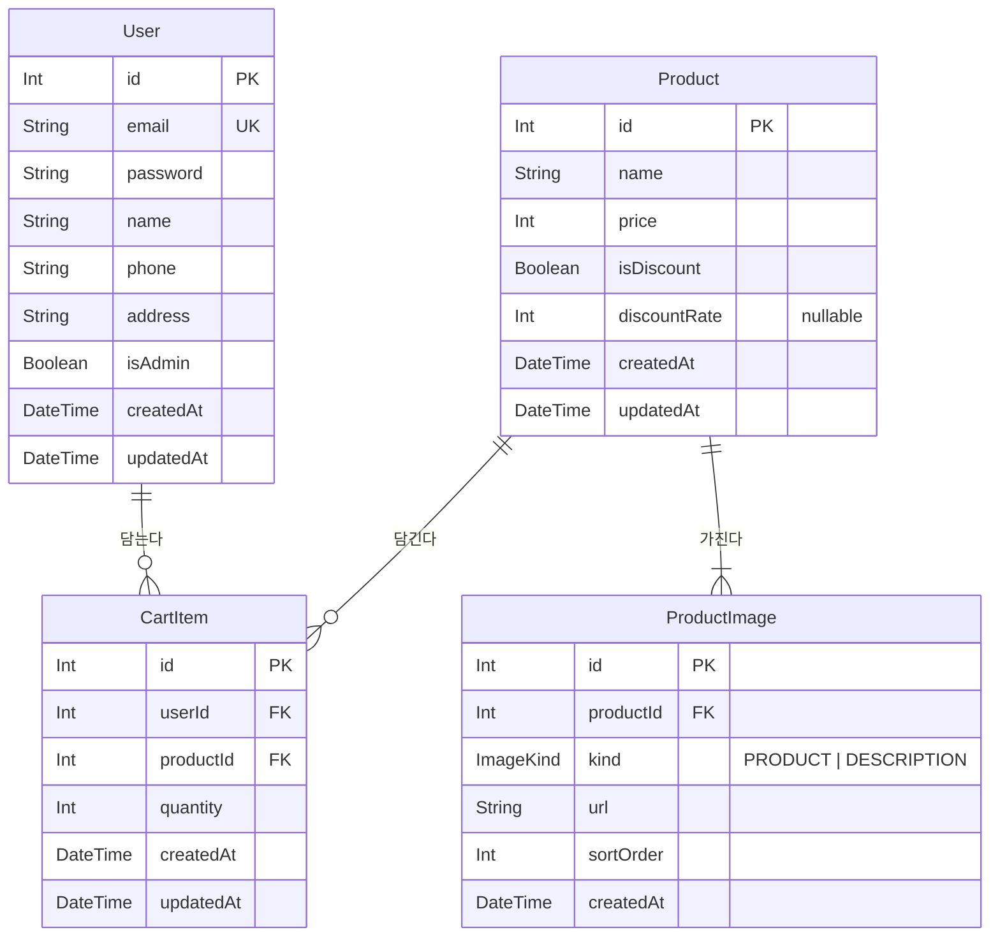

# BJShoppingmall DB 설계

> 기준 문서: `요구사항.md` v1.1
> ORM: Prisma / DB: mysql [추정 — `provider`만 바꾸면 MySQL, SQLite로 옮길 수 있다]

---

## 1. 설계 범위

| 요구사항 | DB 반영 |
| --- | --- |
| 회원가입/로그인, 관리자 구분 (5.1) | `User` 테이블 |
| 제품 등록/수정/삭제 (5.2) | `Product` 테이블 |
| 제품 사진, 제품 설명 사진 (최대 10장, 순서 있음) | `ProductImage` 테이블 (`kind`로 구분) |
| 장바구니, 수량 (5.3) | `CartItem` 테이블 |
| 바로 구매 (Q-09) | **DB에 저장하지 않음**. 제품 ID와 수량을 구매 페이지로 전달 |
| 구매 완료 처리, 주문 (Q-08) | **이번 범위 제외**. 7장에 추후 설계안만 둔다 |
| 재고 (Q-14), 마이페이지 (Q-03) | 반영하지 않음 |

---

## 2. ERD



---

## 3. 테이블 정의

### 3.1 User (회원)

| 컬럼 | 타입 | 제약 | 설명 |
| --- | --- | --- | --- |
| id | Int | PK, 자동 증가 | 회원 식별자 |
| email | String | UNIQUE, NOT NULL | 로그인 ID |
| password | String | NOT NULL | bcrypt 해시 (NFR-01) |
| name | String | NOT NULL | 이름 |
| phone | String | NOT NULL | 전화번호. `010-1234-5678` 같은 형식을 그대로 저장하려고 문자열 사용 |
| address | String | NOT NULL | 주소 |
| isAdmin | Boolean | NOT NULL, 기본값 false | 관리자여부. 회원가입 API에서는 설정하지 않고 DB에서 직접 바꾼다 (Q-02, NFR-02) |
| createdAt | DateTime | 기본값 now() | 가입일시 |
| updatedAt | DateTime | 자동 갱신 | 수정일시 |

### 3.2 Product (제품)

| 컬럼 | 타입 | 제약 | 설명 |
| --- | --- | --- | --- |
| id | Int | PK, 자동 증가 | 제품 식별자 |
| name | String | NOT NULL | 제품명 (Q-01) |
| price | Int | NOT NULL | 가격(원). 0 이상 |
| isDiscount | Boolean | NOT NULL, 기본값 false | 할인여부 |
| discountRate | Int | NULL 허용 | 할인율(%), 1~100. 할인 체크를 꺼도 값을 지우지 않는다 (Q-11) |
| createdAt | DateTime | 기본값 now() | 등록일시. 메인 화면 정렬에 사용 (최신순) [추정] |
| updatedAt | DateTime | 자동 갱신 | 수정일시 |

- **할인 가격은 컬럼으로 두지 않는다.** 화면에 보여줄 때 `Math.round(price * (1 - discountRate / 100))`로 계산한다 (Q-12). 가격이나 할인율이 바뀌어도 값이 어긋날 일이 없다.
- `isDiscount = true`이면 `discountRate`가 있어야 한다. 이 규칙은 서버에서 검사한다 (4장).

### 3.3 ProductImage (제품 사진 / 제품 설명 사진)

| 컬럼 | 타입 | 제약 | 설명 |
| --- | --- | --- | --- |
| id | Int | PK, 자동 증가 | 사진 식별자 |
| productId | Int | FK → Product.id, ON DELETE CASCADE | 소속 제품 |
| kind | ImageKind | NOT NULL | `PRODUCT`(제품 사진) / `DESCRIPTION`(설명 사진) |
| url | String | NOT NULL | 업로드된 파일 경로 (예: `/uploads/products/abc.jpg`) |
| sortOrder | Int | NOT NULL | 화면에 나열할 순서 (0부터) |
| createdAt | DateTime | 기본값 now() | 업로드일시 |

- 인덱스: `(productId, kind, sortOrder)` — 제품의 사진을 종류별로 순서대로 조회할 때 쓴다.
- **두 종류를 한 테이블에 둔 이유**: 컬럼 구성이 같고, 추가/삭제/순서 처리 코드를 같이 쓸 수 있다.
- **메인 카드 썸네일**은 `kind = PRODUCT`이고 `sortOrder`가 가장 작은 사진이다.
- DB에는 파일 경로만 저장하고 이미지 파일은 서버의 업로드 폴더(또는 스토리지)에 둔다 (NFR-04).

### 3.4 CartItem (장바구니)

| 컬럼 | 타입 | 제약 | 설명 |
| --- | --- | --- | --- |
| id | Int | PK, 자동 증가 | 식별자 |
| userId | Int | FK → User.id, ON DELETE CASCADE | 회원 |
| productId | Int | FK → Product.id, ON DELETE CASCADE | 제품. 제품을 지우면 장바구니 항목도 지워진다 (NFR-05) |
| quantity | Int | NOT NULL | 수량. 1 이상 |
| createdAt | DateTime | 기본값 now() | 담은 일시. 장바구니 표시 순서 |
| updatedAt | DateTime | 자동 갱신 | 수량 변경일시 |

- UNIQUE `(userId, productId)`: 한 회원의 장바구니에 같은 제품은 한 줄만 둔다. 다시 담으면 `quantity`를 더한다 (Q-19 가정).
- 관리자는 장바구니를 쓰지 않는다 (Q-15). DB로는 막을 수 없으므로 서버 API에서 막는다.

---

## 4. DB 밖에서 지켜야 하는 규칙

Prisma 스키마로 표현할 수 없는 규칙이다. 서버에서 검사한다 (NFR-07).

| 규칙 | 근거 | 검사 시점 |
| --- | --- | --- |
| `price >= 0` | 5.2 | 제품 등록/수정 |
| `isDiscount = true`이면 `discountRate`가 1~100 | 5.2 | 제품 등록/수정 |
| `kind = PRODUCT` 사진이 **1장 이상 10장 이하** | Q-13 | 제품 등록/수정 저장 |
| `kind = DESCRIPTION` 사진 개수 제한 없음 | Q-16 가정 | — |
| `quantity >= 1` | 5.3 | 장바구니 담기/수량 변경 |
| 회원가입 요청의 `isAdmin`은 무시 | NFR-02 | 회원가입 |
| 장바구니 API는 `isAdmin = false`만 사용 | Q-15 | 장바구니 API |

> 원하면 마이그레이션 SQL에 `CHECK` 제약(`price >= 0`, `quantity >= 1`, `discountRate BETWEEN 1 AND 100`)을 직접 추가해 DB에서도 한 번 더 막을 수 있다.

---

## 5. Prisma 스키마

```prisma
generator client {
  provider = "prisma-client-js"
}

datasource db {
  provider = "mysql"
  url      = env("DATABASE_URL")
}

model User {
  id        Int        @id @default(autoincrement())
  email     String     @unique
  password  String
  name      String
  phone     String
  address   String
  isAdmin   Boolean    @default(false)
  createdAt DateTime   @default(now())
  updatedAt DateTime   @updatedAt

  cartItems CartItem[]
}

model Product {
  id           Int            @id @default(autoincrement())
  name         String
  price        Int
  isDiscount   Boolean        @default(false)
  discountRate Int?
  createdAt    DateTime       @default(now())
  updatedAt    DateTime       @updatedAt

  images       ProductImage[]
  cartItems    CartItem[]
}

enum ImageKind {
  PRODUCT
  DESCRIPTION
}

model ProductImage {
  id        Int       @id @default(autoincrement())
  productId Int
  kind      ImageKind
  url       String
  sortOrder Int
  createdAt DateTime  @default(now())

  product   Product   @relation(fields: [productId], references: [id], onDelete: Cascade)

  @@index([productId, kind, sortOrder])
}

model CartItem {
  id        Int      @id @default(autoincrement())
  userId    Int
  productId Int
  quantity  Int
  createdAt DateTime @default(now())
  updatedAt DateTime @updatedAt

  user      User     @relation(fields: [userId], references: [id], onDelete: Cascade)
  product   Product  @relation(fields: [productId], references: [id], onDelete: Cascade)

  @@unique([userId, productId])
}
```

---

## 6. 화면별 주요 데이터 처리

| 화면 / 동작 | 처리 |
| --- | --- |
| 메인 화면 목록 | `Product`를 `createdAt` 내림차순으로 조회. `images`는 `kind = PRODUCT`, `sortOrder` 오름차순, 1장만 |
| 상세 화면 | `Product` 1건 + `images` 전체를 `kind`별로 `sortOrder` 순서로 조회 |
| 회원가입 | `User` 생성. `isAdmin`은 넣지 않아 기본값 false |
| 관리자 지정 | DB에서 직접 `UPDATE "User" SET "isAdmin" = true WHERE email = '...'` |
| 장바구니 담기 | `CartItem` upsert: 없으면 생성, 있으면 `quantity += 선택 수량` |
| 장바구니 수량 변경 | `CartItem.quantity` 수정 |
| 장바구니 취소하기 | 해당 회원의 `CartItem` 전부 삭제 (`deleteMany({ where: { userId } })`) |
| 장바구니 → 구매 페이지 | 해당 회원의 `CartItem` + `Product` + 썸네일 조회 |
| 바로 구매 → 구매 페이지 | DB에 저장하지 않음. `productId`, `quantity`를 전달하고 `Product`만 조회 |
| 제품 등록 저장 | 트랜잭션: `Product` 생성 + `ProductImage` 생성 |
| 제품 수정 저장 | 트랜잭션: `Product` 수정 → 화면에서 뺀 사진 삭제 → 새 사진 생성 → 남은 사진 `sortOrder` 갱신 (Q-10, NFR-06) |
| 제품 삭제 | `Product` 삭제 → `ProductImage`, `CartItem`은 CASCADE로 함께 삭제. 업로드 파일은 서버에서 따로 지운다 |

---

## 7. 추후 확장 (이번 범위 제외)

구매 완료 처리(Q-08)를 만들 때 추가할 테이블 초안이다.

| 테이블 | 주요 컬럼 | 설명 |
| --- | --- | --- |
| Order | id, userId, totalPrice, address, status, createdAt | 주문 1건. 주문 당시 배송지를 저장 |
| OrderItem | id, orderId, productId(NULL 허용), productName, unitPrice, quantity | 주문 당시 제품명과 가격을 함께 저장한다. 나중에 제품이 수정·삭제돼도 주문 내역이 바뀌지 않게 하기 위함 |
